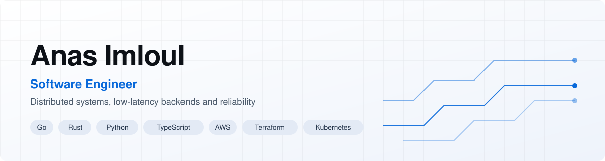

<picture>
  <source media="(prefers-color-scheme: dark)" srcset="assets/banner-dark.svg">
  
</picture>

I'm a software engineer at **BCG X** in Casablanca, working on distributed backends and the reliability work around them: latency profiling, capacity planning, failure handling under provider quotas, and infrastructure as code. I shipped a production real-time voice platform on OpenShift, and I build systems tools in Rust and Go on the side.

Engineering diploma from **INPT** (2024). IEEEXtreme 17.0 top 6% globally, 2nd in Morocco.

## Selected work

| Project | What it is | Stack |
| --- | --- | --- |
| [**jsq**](https://github.com/AnasImloul/jsq) | SQL-shaped query language for multi-GB JSON. Single memory-mapped pass, about 34 MiB of RAM on a 1 GB file. | Rust |
| [**diagr**](https://github.com/AnasImloul/diagr) | Declarative diagrams in YAML: static SVG in light and dark, plus a self-contained interactive page. [Demo](https://anasimloul.github.io/diagr/) | HTML |
| [**procedural-art**](https://github.com/AnasImloul/procedural-art) | Seeded, deterministic landscape art: stills, SVG and looping video. [Live](https://landscapes.imloul.com) | TypeScript |
| [**twenty48**](https://github.com/AnasImloul/twenty48) | A 2048 engine and an expectimax agent that plays it to 32768. | Rust |
| [**domjudge-cli**](https://github.com/AnasImloul/domjudge-cli) | CLI to set up and manage coding contests on DOMjudge. | Python |
| **Prism** | Event-driven video platform on AWS: SQS-fed FFmpeg workers, HLS via Cloudflare, Terraform, runbook. [prism.imloul.com](https://prism.imloul.com) | Go, Terraform |

## Stack

**Languages** C++, Go, Rust, Python, Java, TypeScript, SQL  
**Systems** gRPC, WebSockets, Redis, PostgreSQL, MongoDB, DynamoDB, SQS  
**Infrastructure** AWS, Kubernetes, OpenShift, Docker, Terraform, CI/CD

## Elsewhere

[Website](https://imloul.com) · [LinkedIn](https://www.linkedin.com/in/anas-imloul/) · [LeetCode solutions](https://github.com/AnasImloul/Leetcode-Solutions) (7,000+ solutions, 400+ stars)
